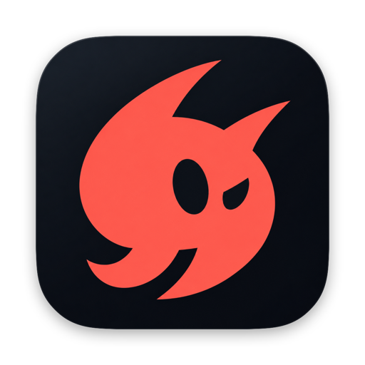

<p align="center">
  
</p>

<h1 align="center">Saynori</h1>

<p align="center"><b>Talk. It types.</b></p>

<p align="center">
  Hold <kbd>fn</kbd>, speak naturally, let go.<br>
  Clean, formatted text appears wherever your cursor is.
</p>

<p align="center">
  Native macOS &nbsp;·&nbsp; On-device or any cloud &nbsp;·&nbsp; 26 MB of memory &nbsp;·&nbsp; 0% CPU at rest
</p>

<br>

## In action

Everything below was formatted on the Mac in about a millisecond, by rules rather than a language model. Saynori edits the words you said. It never invents new ones.

```text
"Um so for the launch, first fix the login bug, second ship the new onboarding,
 no wait, the new pricing page, and third email priya at gmail dot com before
 three thirty pm."

→  So for the launch:

   1. Fix the login bug
   2. Ship the new pricing page
   3. Email priya@gmail.com before 3:30 PM
```

```text
"Bro, add a use effect hook in the next js app and put the super base key in
 dot env. Then push it to git hub."

→  Add a useEffect hook in the Next.js app and put the Supabase key in .env.
   Then push it to GitHub.
```

```text
"We're at twenty k users and the API costs about five hundred dollars a month,
 uh, roughly fifty percent of the budget."

→  We're at 20k users and the API costs about $500 a month, roughly 50% of the budget.
```

## Light by design

| Measured on an M4 MacBook Air | |
|---|---|
| Memory | **26 MB** with the speech model loaded |
| CPU at rest | **0%** |
| Speech to text, on device | **≈ 0.07 s** for an 8-second dictation |
| CPU per dictation | **≈ 0.08 s**, because the Neural Engine does the heavy lifting |
| Formatting | **≈ 1 ms** |
| App size | **17 MB** |

Memory is the footprint Activity Monitor reports. Core ML maps the speech model from disk, so the model doesn't sit in the app's memory. The microphone is only on while you're talking.

## Engines

Choose a speech engine and a formatter separately. Mix them freely, for example Parakeet for speech and Gemini for formatting, and switch any time.

### On your Mac

| Engine | Speed | Memory | Download | Languages |
|---|---|---|---|---|
| **Parakeet v3** by NVIDIA, on the Neural Engine | ≈ 0.07 s | + 34 MB | 469 MB | English and 24 European languages |
| **Whistle** by Cactus, on the CPU | ≈ 0.08 s | + 38 MB | 17 MB | English and 6 European languages |
| **Gemma 4 E4B** by Google, via Ollama | ≈ 2 s | ≈ 5 GB | 6.1 GB | Many languages |

Speed is for an 8-second dictation. Nothing you say leaves your Mac.

### In the cloud

| Provider | Speech | Formatting |
|---|---|---|
| **OpenAI** | gpt-4o-mini-transcribe | GPT-4.1 mini |
| **Google Gemini** | Gemini Flash | Gemini Flash |
| **Groq** | Whisper large v3 turbo | Llama 3.3 70B |
| **Deepgram** | Nova-3 | Speech only |
| **ElevenLabs** | Scribe, 99 languages | Speech only |
| **Cartesia** | Ink-Whisper | Speech only |
| **Sarvam** | Saaras v4, Indian languages and Hinglish | Sarvam 105B |

Bring your own API key. Saynori tests each key with a real request when you save it.

### Formatting

- **Instant:** the rules shown above, on your Mac in about 1 ms. This is the default with on-device speech.
- **AI:** Gemma 4 on your Mac, or any cloud model above. This adds Prompt mode and command mode.

## Features

**Writes the way you type**
- Drops "um", "uh" and stutters, and keeps the repeats you mean.
- Follows "no wait", "scratch that", "new line", "new paragraph" and "question mark".
- Turns spoken steps into numbered lists and spoken items into bullet points.
- Writes numbers, money, times, dates, emails and links the way you'd type them.
- Continues your sentence with the right spacing and capitals.

**Speaks developer**
- Say it, get it typed: "192 dot 168 dot 0 dot 1 colon 8080" → `192.168.0.1:8080`, "main dot swift colon 42" → `main.swift:42`.
- Paths, flags and names: "slash users slash me" → `/users/me`, "dash dash port" → `--port`, "API underscore key" → `API_KEY`.
- Operators, shortcuts and colours: "a equals equals b" → `a == b`, "command shift p" → `Cmd+Shift+P`, "hash F F 5733" → `#FF5733`.
- Notation only kicks in inside code editors, terminals and AI tools, so everyday writing stays everyday.

**Knows your words**
- Your Dictionary guides the speech engine wherever the engine supports it, and the formatter always spells it right.
- Fixes 150+ developer terms in code editors and AI chats: useEffect, kubectl, .env, GitHub CLI.
- Leaves URLs, file paths and code exactly as written.

**Made for talking to AI**
- **Prompt mode** turns a rambling thought into a clear prompt in Claude Code, Codex, Cursor, ChatGPT and more. Questions stay questions.
- **Command mode:** hold <kbd>fn</kbd> <kbd>⌃</kbd> and say "make this more formal" to rewrite the selected text.

**Never loses a word**
- With no text field focused, your words wait on the clipboard on a card with a Copy button.
- <kbd>⌃</kbd> <kbd>⌘</kbd> <kbd>V</kbd> pastes your last dictation again.
- Your clipboard is restored after every paste.

**Feels native**
- A thin pixel bar shows your voice, then types your words as they land.
- <kbd>fn</kbd> stops opening the emoji picker, with no logout needed.
- Any key or shortcut can be your dictation key.
- A dashboard holds your history, stats, Dictionary, snippets and writing style.

## Controls

| Do this | To |
|---|---|
| Hold <kbd>fn</kbd>, speak, release | Dictate |
| Double-press <kbd>fn</kbd> | Go hands-free. Press again to insert. |
| Hold <kbd>fn</kbd> <kbd>⌃</kbd> | Use command mode |
| <kbd>esc</kbd> | Cancel |
| <kbd>⌃</kbd> <kbd>⌘</kbd> <kbd>V</kbd> | Paste your last dictation again |

## Install

**[Download the latest release](https://github.com/loopassembly/saynori/releases/latest)**, open the `.dmg` and drag Saynori into Applications. You need macOS 14 or later on Apple Silicon.

This build isn't notarized by Apple yet, so macOS blocks the first launch. Open Saynori once, then go to **System Settings → Privacy & Security** and click **Open Anyway**.

On first launch, a short setup helps you pick an engine, allow the Microphone and Accessibility, choose your key, and try it out.

### Build from source

```bash
git clone https://github.com/loopassembly/saynori.git
cd saynori
./scripts/build-app.sh           # test, build, sign, install to /Applications and open
./scripts/package-release.sh     # or package a .dmg and .zip into build/release
```

You need Xcode's command-line tools.

## Privacy

- With on-device engines, audio and text never leave your Mac.
- With cloud engines, they go only to the providers you choose, using your own keys.
- Keys are stored in `~/Library/Application Support/Saynori/config.json`, readable only by you, and are never built into the app.
- History, stats and your Dictionary stay on your Mac. The diagnostics log never records what you say.

## Development

```bash
swift build -c release
.build/release/Saynori --test-formatter            # formatter test suite (also run by the build script)
.build/release/Saynori --test-formatter --history  # replay your saved dictations through the formatter
.build/release/Saynori --format-local "um so first clone it, second build it and third ship it"
.build/release/Saynori --bench parakeet clip.wav   # speed, CPU time and memory of an on-device engine
```

`build-app.sh` won't install if a formatter test fails. For local testing, API keys can also come from `<PROVIDER>_API_KEY` environment variables (see `.env.example`).
